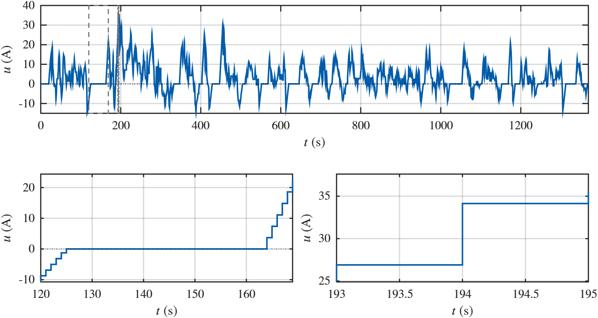

# Battery estimation on the UDDS drive cycle

MATLAB simulation of a two-RC battery model, with parameter identification and online estimation of state of charge (SOC), series resistance, and capacity. The input current is derived from the included EPA UDDS speed trace using a fixed vehicle and pack model.

Current derived from the UDDS speed trace, with close-ups of a rest interval and a current jump.



The script runs two experiments:

1. Identify `R1`, `R2`, `C1`, and `C2` from voltage relaxation during zero-current rests and the load between them. The initial parameter guesses are deliberately offset from the reference values.
2. Estimate the RC voltages, series resistance `Rs`, SOC, and capacity `Q` over the full drive cycle, first without disturbances and then with bounded state disturbances and voltage noise.

The online experiment uses the reference RC parameters in `P`. The rest-based identification results are reported separately and are not passed into the online estimator.

## Run

Use MATLAB R2019b or later. The script uses MATLAB functions without additional toolbox calls.

Set the MATLAB current folder to this repository, then run:

```matlab
battery_estimation_UDDS_publication
```

The script clears the workspace, closes existing figures, and sets graphics defaults for the MATLAB session. It prints identification results, update times, late-cycle estimation errors, and current-profile statistics. Five figures open and are exported to `figures_eps/`, replacing files with the same names.

## Files

| File | Purpose |
| --- | --- |
| `battery_estimation_UDDS_publication.m` | Simulation, estimators, and plotting helpers in one script |
| `epa_udds_speed.csv` | Time in seconds and speed in mph, sampled at 1 Hz from 0 to 1369 s |
| `figures_eps/` | Exported vector figures |
| `figures_png/` | PNG previews, including the current profile shown above |

The CSV must start at zero and have strictly increasing time with one-second spacing. The reader uses the first two columns and removes rows with non-finite values. It looks in the current folder, then beside the script, and otherwise opens a file picker.

## Model and settings

The states are `x1` (SOC as a fraction), `x2` (slow RC voltage), and `x3` (fast RC voltage). Terminal voltage is

```text
y = OCV(x1) - x2 - x3 - Rs*u
```

Positive current means discharge; negative current means regenerative charging. Resistances are in ohms, capacitances in farads, and `Q` in coulombs. The reference capacity is 72,000 C, or 20 Ah. The OCV curve is a polynomial defined in `P.ocv`.

Settings near the top of the script:

| Setting | Default | Meaning |
| --- | --- | --- |
| `TChoice` | 300 s | SOC/capacity regression window |
| `TuChoice` | 60 s | Time between regression attempts |
| `dt` | 0.1 s | Simulation step; must divide one second exactly |
| `x0` | `[0.90; 0.02; 0.01]` | Initial SOC and RC voltages |
| `minRest` | 2 s | Minimum rest duration for RC identification |
| `mu` | 0 | Forgetting rate for resistance estimation |

The current conversion is in `udds_current_epa`: a 1,500 kg vehicle, flat road, 350 V nominal pack voltage, and three parallel cells. It includes rolling resistance, aerodynamic drag, acceleration, and separate traction and regeneration efficiencies. Each derived current sample is held for one second; the simulation does not interpolate the current.

Series resistance is estimated from current and voltage jumps. The noisy case accepts only current jumps of at least 2 A. After removing estimated voltage drops, the estimator inverts the OCV curve to obtain an SOC measurement and fits SOC and inverse capacity over a moving window. Ill-conditioned fits are skipped. The disturbance generator uses seed `2` for repeatable runs.

## Figures

| Output | Contents |
| --- | --- |
| `identification_R1_R2_C1_C2.eps` | RC parameter estimates and reference values |
| `nominal_x23_Rs_Q.eps` | Nominal RC voltages, resistance, and capacity |
| `nominal_x1.eps` | Nominal SOC |
| `uncertainties_Rs_Q.eps` | Resistance and capacity with disturbances |
| `UDDS_original_with_zooms.eps` | Derived current with rest and jump close-ups |
